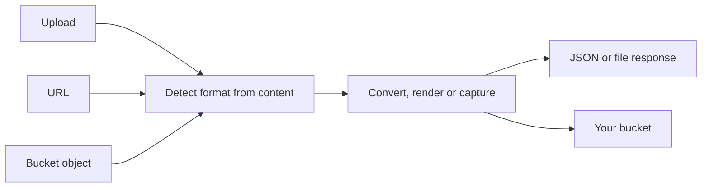

Papyrus turns documents and web pages into LLM-ready Markdown, chunks and images through one HTTP API that runs on your own infrastructure. Send a file, a URL or a storage object, and get back text your model can read or images your users can see.

## What you can do

| You need | Endpoint | Guide |
|---|---|---|
| Text from a PDF, Office file, email or web page for an LLM | `POST /v1/markdown` | [Extract Markdown](./guides/markdown) |
| Chunks sized for your embedding model, with headings and offsets | `POST /v1/markdown` with `chunking` | [Chunk for RAG](./guides/chunking) |
| A page image at reading size, or a fixed size preview | `POST /v1/render`, `POST /v1/thumbnail` | [Thumbnails and renders](./guides/images) |
| A web page as a browser shows it | `POST /v1/screenshot` | [Web page screenshots](./guides/screenshots) |
| Results written straight to your bucket | any endpoint with `destination` | [Storage](./guides/storage) |

## How it works

- **One request shape for every operation.** Every endpoint takes `source`, `options`, `output` and `destination`, and returns the same `source`, `options`, `result` envelope. Learn it once in [request format](./concepts/requests).
- **Formats are detected from the content.** A PDF named `report.docx` is processed as a PDF, and the response tells you what it really was.
- **The heavy tools ship in the image.** LibreOffice for legacy office formats and Chromium for web pages run inside Papyrus, so your services do not install or sandbox them.
- **Your documents stay in your network.** Papyrus runs as one Docker image next to your services. It fetches only the URLs you send and what those pages load, and blocks private addresses by default.

## Limits to know up front

- Papyrus reads the text layer of PDFs and does not run OCR: scanned documents return little or no text.
- One request processes one document, up to 100 MB and 300 seconds by default.
- Render and thumbnail return one page per request.

Papyrus is built by [Axelered](https://axelered.com).

<Cards>
  <Card title="Quickstart" description="Run Papyrus and extract your first document in five minutes" href="./quickstart" />
  <Card title="API reference" description="Every endpoint, field and error, with examples" href="./api" />
</Cards>
