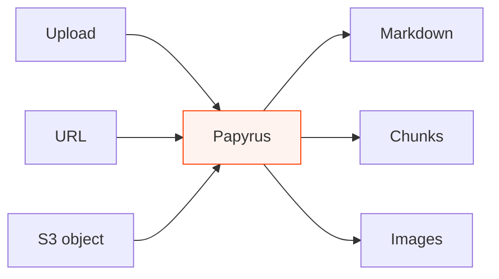

import { Camera, FileText, ImageIcon, Scissors } from 'lucide-react'

Papyrus is a self-hosted HTTP API that converts documents and web pages into Markdown, chunks and images for LLM and Agentic pipelines. It reads PDFs, Office files, emails, HTML pages and other formats listed in [File formats](./formats), and returns content in a shape that models and retrieval systems can use directly.

 
<Cards>
  <Card icon={<FileText />} title="Markdown extraction" description="PDF, Office, email and HTML to Markdown" href="./markdown" />
  <Card icon={<Scissors />} title="RAG chunking" description="Structure-aware chunks with headings, token counts and offsets" href="./chunking" />
  <Card icon={<ImageIcon />} title="Image rendering" description="Page renders and fixed-size thumbnails" href="./images" />
  <Card icon={<Camera />} title="Web screenshots" description="Web page capture in headless Chromium" href="./screenshots" />
</Cards>
 

## How it works

Papyrus takes a document from an upload, a URL or an object in your S3 bucket. It detects the format from the file content, converts or renders it, and returns Markdown, chunks or images in the response, or writes them back to your bucket.

 

 

Behind that single API sits the machinery document processing needs: LibreOffice for Office formats, PDFium for PDF rendering, headless Chromium for web pages, content-based format detection and structure-aware chunking. Papyrus runs each of these in its own worker processes, keeps them warm, and applies [production hardened Security](./security) for untrusted documents and websites. Your agents call one endpoint and receive clean content, and none of these tools has to be installed, patched or scaled inside your own services.

## Deployment

Papyrus ships as a single stateless Docker image with every component included. It stores nothing between requests, and throughput scales horizontally by adding replicas behind a load balancer. [Docker setup](./docker) and [Sizing](./sizing) describe the configuration and capacity planning.

Papyrus is built by [Axelered](https://axelered.com).

 
<Cards>
  <Card title="Quickstart" description="Run Papyrus and convert a first document" href="./quickstart" />
  <Card title="API reference" description="Endpoints, fields, errors and examples" href="./api" />
</Cards>
